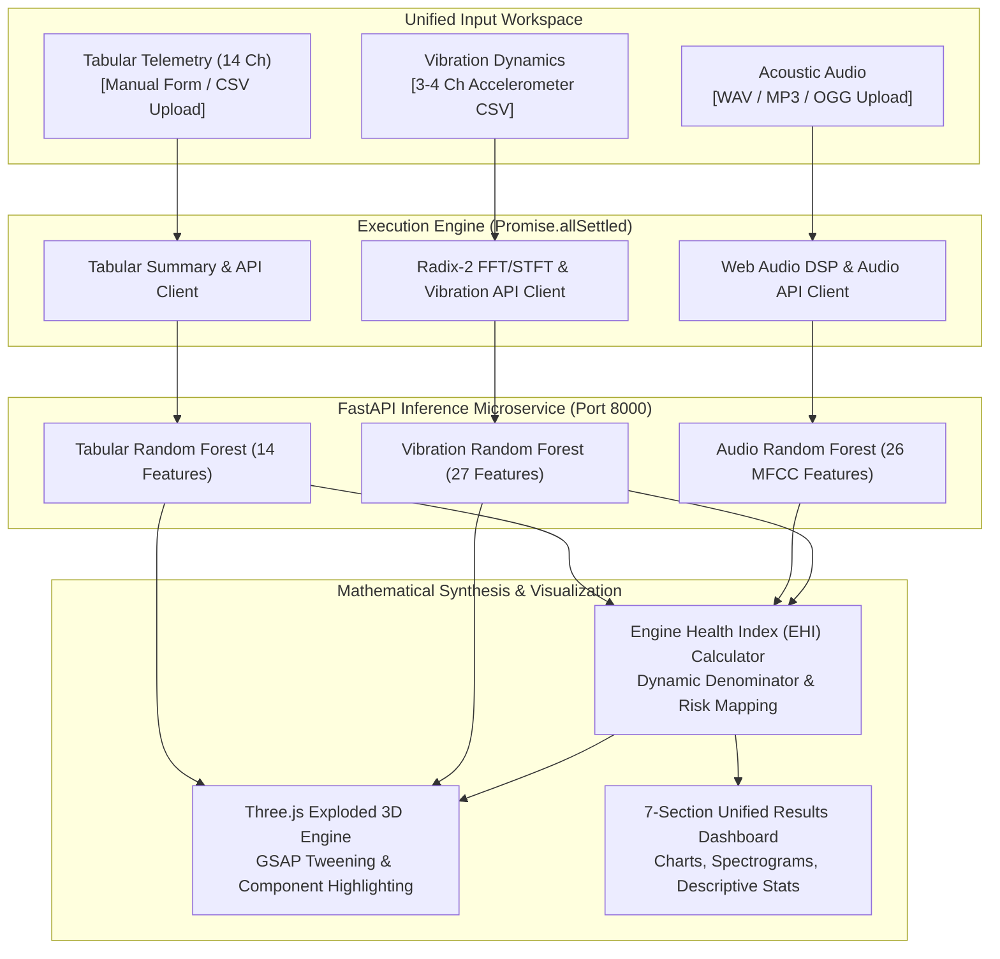

# EngineGuard / EnginePulse 🛡️⚙️
### Production-Grade Unified Multi-Stream Engine Diagnostic System

[](https://www.python.org/)
[](https://fastapi.tiangolo.com/)
[](https://react.dev/)
[](https://threejs.org/)
[](https://vitejs.dev/)
[]()

EngineGuard (branded as **EnginePulse Diagnostic Lab**) is an advanced automotive condition-monitoring platform. It unites three independent machine-learning diagnostic streams—**engine thermodynamic telemetry**, **acoustic audio frequency analysis**, and **accelerometry vibration dynamics**—into a unified, real-time diagnostic workspace with an experimental **Bearing RUL Simulation Sandbox** and client-side **Diagnostic PDF Report Export**.

The application allows automotive technicians and test engineers to supply **1, 2, or all 3 data streams** in any combination, execute concurrent neural/kinematic inference via a single **`ANALYZE MY ENGINE →`** action, compute a mathematically rigorous **Engine Health Index (EHI)**, and inspect the engine in an interactive **exploded 3D CAD canvas**.

---

## 📑 Table of Contents

- [System Architecture](#-system-architecture)
- [Key Features](#-key-features)
- [Engine Health Index (EHI) Mathematical Specification](#-engine-health-index-ehi-mathematical-specification)
- [Client-Side DSP & Spectral Analysis Engine](#-client-side-dsp--spectral-analysis-engine)
- [Unified Results Dashboard (Part 8 Specification)](#-unified-results-dashboard-part-8-specification)
- [Interactive 3D Engine Inspection Canvas](#-interactive-3d-engine-inspection-canvas)
- [Machine Learning Models & Provenance](#-machine-learning-models--provenance)
- [REST API Reference](#-rest-api-reference)
- [Quick Start Guide](#-quick-start-guide)
- [Automated Verification & Test Suite](#-automated-verification--test-suite)
- [Project Layout](#-project-layout)
- [Engineering Caveats & Diagnostic Scope](#-engineering-caveats--diagnostic-scope)

---

## 🏛️ System Architecture



---

## ✨ Key Features

- **Multi-Stream Input Freedom**: Analyze any non-empty subset of inputs ($2^3 - 1 = 7$ non-empty combinations):
  - *Single-stream*: Tabular-only, Audio-only, or Vibration-only
  - *Dual-stream*: Tabular + Audio, Tabular + Vibration, or Audio + Vibration
  - *Full tri-stream*: Tabular + Audio + Vibration simultaneously
- **Independent Stream Inclusion Toggles**: Enable, disable, or clear each stream independently.
- **14-Sensor Manual Input Form**: High-precision automotive telemetry input interface with strict numeric validation, unit badges, and out-of-range training warnings across 5 mechanical categories (Intake, Kinematics, Fuel, Combustion, Emissions).
- **In-Browser High-Performance DSP**: Real-time Radix-2 Cooley-Tukey FFT, Hann windowing, coherent gain normalization, and STFT spectrogram heatmaps computed entirely on the client thread.
- **Engine Health Index (EHI)**: Transparent formula computation with live mathematical substitution, normalized weights, dynamic applicability denominators, and zero-risk imputation safeguards.
- **Bearing RUL Simulation Sandbox**: Experimental heuristic sandbox modeling run-to-threshold bearing degradation against 600 synthetic Weibull/lognormal trajectories with 10th–90th percentile bounds and synthetic dataset export.
- **Client-Side Diagnostic PDF Export**: Clean, high-resolution vector PDF reports generated entirely in-browser with jsPDF, embedding sensor readings, classification provenance, and waveform/spectrum plots.
- **Fault Attribution in 3D**: Direct mapping of detected faults to interactive 3D engine components (pistons, connecting rods, crankshaft, valves, cylinder head) using GSAP smooth camera dollying and mesh explosion animations.

---

## 🧮 Engine Health Index (EHI) Mathematical Specification

The Engine Health Index synthesizes all applicable model predictions into a single, standardized composite metric on a $0 \text{ to } 100$ scale.

### 1. Final Formula

$$EHI = 100 \times \left(1 - \frac{0.697 R_E + 0.084 R_A + 0.219 R_V}{0.697 I_E + 0.084 I_A + 0.219 I_V}\right)$$

Where:
- $I_E, I_A, I_V \in \{0, 1\}$ are binary indicators: **$1$ when the respective model's output is applicable**, and **$0$ when omitted, failed, or excluded**.
- $R_E, R_A, R_V \in \{0, 1\}$ are the discrete risk scores assigned to each model's prediction.
- The dynamic denominator guarantees that missing or excluded streams never penalize or artificially inflate engine health.
- If all streams are omitted or excluded ($\sum W_i I_i = 0$), the index reports **Unavailable** (never zero).

### 2. Risk Value Definitions

| Stream | Model Source | Condition / Predicted Class | Risk ($R_i$) | Indicator ($I_i$) |
|---|---|---|:---:|:---:|
| **Tabular ($R_E$)** | `EngineFaultDB` | Class 0: `Normal (no fault)` | **0** | 1 |
| | | Class 1: `Rich mixture` | **1** | 1 |
| | | Class 2: `Lean mixture` | **1** | 1 |
| | | Class 3: `Low voltage` | **1** | 1 |
| **Audio ($R_A$)** | Acoustic RF | `Normal engine` | **0** | 1 |
| | | `Engine issue` | **1** | 1 |
| | | `Non-engine issue` *(excluded per spec)* | **null** | **0** |
| **Vibration ($R_V$)** | Bearing Dynamics | `Healthy bearing` / `Healthy` | **0** | 1 |
| | | `Faulty bearing` / `Faulty` | **1** | 1 |

### 3. Score Interpretation Standards

- **$\text{EHI} = 100.0$**: No applicable model detected a fault ($R_i = 0$ across all active streams).
- **$\text{EHI} = 0.0$**: All applicable models detected a fault ($R_i = 1$ across all active streams).
- **$0.0 < \text{EHI} < 100.0$**: A weighted combination of fault signals across active streams.
  - *Example 1 (Tabular Normal + Audio Issue + Vibration Normal)*: $\text{EHI} = 100 \times (1 - 0.084 / 1.0) = \mathbf{91.6}$
  - *Example 2 (Tabular Fault + Audio Normal + Vibration Normal)*: $\text{EHI} = 100 \times (1 - 0.697 / 1.0) = \mathbf{30.3}$
  - *Example 3 (Tabular Normal + Vibration Fault, Audio Missing)*: $\text{EHI} = 100 \times (1 - 0.219 / 0.916) = \mathbf{76.1}$

---

## 📡 Client-Side DSP & Spectral Analysis Engine

EngineGuard includes a purpose-built, pure TypeScript digital signal processing engine located at [`frontend/src/lib/signalProcessing.ts`](file:///d:/engineguard/frontend/src/lib/signalProcessing.ts):

1. **Cooley-Tukey Radix-2 DIT FFT**:
   - Zero-padding to the next power of two ($N = 2^k$).
   - In-place bit-reversal permutation and decimation-in-time butterflies.
2. **Windowed Single-Sided Spectrum**:
   - Hann windowing: $w[n] = 0.5 \left(1 - \cos\left(\frac{2\pi n}{N - 1}\right)\right)$.
   - Coherent gain normalization using exact equivalent noise bandwidth: $S_1 = \sum_{n=0}^{N-1} w[n]$.
   - Single-sided amplitude: $A[k] = \frac{2 |X[k]|}{S_1}$ for bins $1 \le k < N/2$.
   - DC centering ($x[n] - \bar{x}$) to eliminate spectral leakage from DC bias.
3. **STFT Spectrogram Matrix Generation**:
   - Overlapped sliding window analysis (50%–75% overlap).
   - Dynamic frequency scale derive ($0 \text{ to } f_s / 2$).
   - Normalized magnitude matrix $[T \times F]$ rendered as high-contrast viridis/flame heatmaps.
4. **Multi-Channel Accelerometry Parser**:
   - Robust detection of Channel 1–Channel 4 accelerometer streams.
   - Rejection of kurtosis and rear-drive reference columns.
   - Timestamp jitter analysis, duplicate timestamp averaging, and uniform linear resampling.
5. **Web Audio API Ingestion**:
   - Dual-channel stereo downmix: $x_{\text{mono}}[n] = \frac{x_L[n] + x_R[n]}{2}$.
   - Dual-channel peak tracking and dBFS conversion.

---

## 📊 Unified Results Dashboard (Part 8 Specification)

The results view renders all analytical outputs in the exact order specified in Part 8:

1. **Results Header**: Overall health status, analysis timestamp, and stream count inventory.
2. **Three Diagnostic Output Cards**: Dedicated cards for Tabular, Audio, and Vibration in strict sequence with status badges, confidence scores, and affected component hypotheses.
3. **Combined Diagnostic Summary**: Synthesized consensus finding, automatic cross-stream divergence detection, and diagnostic scope caveats.
4. **Tabular Data Summary & Statistics**: Row/column counts, data types, missing value audit, descriptive statistics table (mean, std dev, min, max, median), and 5-row preview (CSV) or single observation display (manual entry).
5. **Audio Signal Analysis**: Waveform plot (normalized time domain), windowed FFT spectrum, and STFT time-frequency spectrogram.
6. **Vibration Signal Analysis**: Waveform plot, windowed FFT spectrum, RMS acceleration comparison across Ch1–Ch4, multi-channel overlay comparison, and STFT spectrogram.
7. **Engine Health Index Card**: Large score gauge, live mathematical formula substitution block, contributing stream breakdown table with effective normalized weights, and verbatim mandatory interpretation notice.

---

## 🛰️ Interactive 3D Engine Inspection Canvas

EngineGuard integrates a 3D C14NE 4-cylinder engine model built with **Three.js** and **GSAP**:

- **Real-Time Mesh Explosion**: Smoothly separates engine components along their mechanical explosion trajectories upon analysis.
- **Component Attribution**: Highlights the identified faulty subsystem (Crankshaft, Connecting Rods, Valves, Cylinder Head, Valve Cover) in high-contrast orange emissive materials.
- **Interactive Inspection**: Full orbit controls, rotation dampening, pan/zoom, and one-click component inspection tooltips with material descriptions and mechanical functions.
- **View Toggle**: Switch effortlessly between the full **Diagnostic Report Dashboard** and the **3D CAD Inspection Canvas**.

---

## 🤖 Machine Learning Models & Provenance

### 1. Engine Telemetry (`src/inference.py`)
- **Dataset**: `EngineFaultDB_Final.csv` (55,998 audited rows; 14 features).
- **Features**: RPM, MAP, TPS, Force, Power, Speed, CO, HC, CO2, O2, Lambda, AFR, Consumption L/H, Consumption L/100KM.
- **Model**: Random Forest Classifier (`models/benchmark_random_forest.joblib`).
- **Benchmark Performance**: 75.42% accuracy, 76.23% macro F1 score.

### 2. Vibration Dynamics (`src/vibration_inference.py`)
- **Dataset**: Engine Journal Bearings Dataset 2 (134 multi-channel accelerometer recordings; 90 Faulty, 44 Healthy).
- **Features**: 27 time-domain and normalized spectral features across 3 channels.
- **Model**: Random Forest Classifier with 300 estimators (`models/vibration_random_forest.joblib`).
- **Benchmark Performance**: 94.12% accuracy, 93.28% balanced accuracy, 93.28% macro F1 score.

### 3. Acoustic Audio (`src/audio_inference.py`)
- **Dataset**: 297 engine audio recordings (85 Engine Issue, 106 Non-engine issue, 106 Normal engine).
- **Features**: 26 MFCC summary statistics (mean & standard deviation of 13 MFCC coefficients extracted at 22,050 Hz).
- **Model**: Tuned Random Forest Classifier (`models/audio/audio_random_forest_tuned.joblib`).
- **Benchmark Performance**: 68.33% accuracy, 67.91% macro F1 score.

---

## 🔌 REST API Reference

The backend is built with FastAPI and runs on `http://127.0.0.1:8000`.

### Health Check
```http
GET /health
```
**Response**:
```json
{
  "status": "ok",
  "models": {
    "tabular": true,
    "vibration": true,
    "audio": true
  }
}
```

### 1. Tabular Telemetry Inference
```http
POST /predict/tabular
Content-Type: application/json
```
```json
{
  "RPM": 4500, "MAP": 75.0, "TPS": 42.0, "Force": 220.0, "Power": 85.0,
  "Speed": 120.0, "CO": 0.8, "HC": 150.0, "CO2": 12.5, "O2": 1.2,
  "Lambda": 0.98, "AFR": 14.2, "Consumption L/H": 8.5, "Consumption L/100KM": 7.1
}
```
*(Also accepts multipart/form-data CSV upload).*

### 2. Vibration Accelerometer Inference
```http
POST /predict/vibration
Content-Type: multipart/form-data
```
Body: `file` (CSV timeseries containing accelerometer channels).

### 3. Acoustic Audio Inference
```http
POST /predict/audio
Content-Type: multipart/form-data
```
Body: `file` (WAV/MP3 audio recording).

---

## 🚀 Quick Start Guide

### Prerequisites
- Python 3.10+ (Python 3.11 recommended)
- Node.js 18+ & npm

### 1. Start the Backend API

```powershell
# In Terminal 1 (Repository Root: d:\engineguard)
python -m venv .venv
.\.venv\Scripts\Activate.ps1
python -m pip install -r requirements.txt
python -m uvicorn backend.app:app --host 127.0.0.1 --port 8000 --reload
```
Interactive API docs are available at [http://127.0.0.1:8000/docs](http://127.0.0.1:8000/docs).

### 2. Start the Frontend Application

```powershell
# In Terminal 2 (Frontend Directory: d:\engineguard\frontend)
cd frontend
npm install
npm run dev
```
Open [http://localhost:5173](http://localhost:5173) in your browser.

---

## 🧪 Automated Verification & Test Suite

The project includes an end-to-end automated test suite covering signal processing, input validation, and EHI mathematics.

Run all tests directly:
```powershell
cd frontend
npm test
```

### Test Suite Summary (60+ Assertions & Tests Passing):
- **DSP Test Suite (`tests/signalProcessing.test.ts`) — 15 Tests**:
  - `Cooley-Tukey FFT & nextPowerOfTwo correctness`
  - `Pure Sine Wave (fs=4000 Hz, f0=250 Hz, A=1.0) peak detection`
  - `Two-Tone Signal (120 Hz + 500 Hz) spectral resolution`
  - `Silence & Zero-Signal edge cases (no NaNs or infinite loops)`
  - `Nyquist boundaries across 8 kHz, 16 kHz, 44.1 kHz, 48 kHz`
  - `STFT Spectrogram time-frequency matrix bounds`
  - `Vibration CSV parser kurtosis/rear column exclusion`
  - `Jitter detection & uniform linear resampling`
  - `Malformed CSV handling & descriptive error reporting`
  - `Stereo (L+R)/2 downmix & multi-channel peak tracking`
  - `DC-offset centering & spectral leakage prevention`
  - `Zero-valued channel quality warning flags`
  - `Odd-length signal windowing & FFT stability`
  - `Resampling interpolation without extrapolation`
  - `UTF-8 BOM, quoted headers, and whitespace tolerance`
- **Tabular Validation Suite (`tests/tabularValidation.test.ts`) — 9 Tests**:
  - `TELEMETRY_FEATURE_DEFS exact 14 features without target column`
  - `Category mappings & valid numerical ranges`
  - `Verified dataset examples (Classes 0, 1, 2, 3)`
  - `14-Channel numeric string parsing`
  - `Rejection of empty fields (no silent zero-coercion)`
  - `Rejection of text, NaN, and Infinity`
  - `Advisory warnings for out-of-training values`
  - `Acceptance of 0 and negative values where valid`
  - `Reversible string conversion for form repopulation`
- **Engine Health Index Suite (`tests/engineHealthIndex.test.ts`) — 17 Tests**:
  - `Case 1: All 3 models nominal -> EHI = 100.0`
  - `Case 2: All 3 models fault -> EHI = 0.0`
  - `Case 3: Tabular only, Class 0 -> EHI = 100.0`
  - `Case 4: Tabular only, Class 2 -> EHI = 0.0`
  - `Case 5: Audio only, Normal engine -> EHI = 100.0`
  - `Case 6: Audio only, Engine issue -> EHI = 0.0`
  - `Case 7: Audio only, Non-engine issue -> EHI Unavailable (excluded)`
  - `Case 8: Vibration only, Healthy bearing -> EHI = 100.0`
  - `Case 9: Vibration only, Faulty bearing -> EHI = 0.0`
  - `Case 10: Tabular (0) + Vibration (1), Audio missing -> dynamic denominator`
  - `Case 11: Failed stream exclusion from numerator & denominator`
  - `Case 12: Zero applicable streams -> EHI Unavailable, never zero`
  - `Case 13: Non-engine issue exclusion while Tabular & Vibration remain`
  - `Case 14: Unknown class labels treated as inapplicable`
  - `Mixed Combination 1: Tabular (0) + Audio (1) + Vibration (0) -> EHI = 91.6`
  - `Mixed Combination 2: Tabular (1) + Audio (0) + Vibration (0) -> EHI = 30.3`
  - `Exact verbatim interpretation warning verification`
- **Bearing RUL Simulation Suite (`tests/rulSimulation.test.ts`) — 17 Assertions**:
  - `Input validation (odometer bounds, threshold checks, non-negative RMS)`
  - `Weibull/Lognormal cohort generation (600 virtual bearings, fixed seed)`
  - `Conditioned nearest-neighbor matching and 10th-90th percentile bounds`
  - `Reproducible synthetic training dataset generation and CSV serialization`
- **Diagnostic PDF Report Suite (`tests/diagnosticPdf.test.ts`)**:
  - `Section structure validation (Telemetry, Audio, Vibration, EHI)`
  - `Exclusion of synthetic RUL from official PDF report`
  - `Valid %PDF- vector output generation with embedded time/frequency plots`

### Backend Automated Verification:
```powershell
# Audio endpoint test (exercises trained MFCC / Random Forest model with bundled MP3)
.\.venv\Scripts\python backend/test_audio_api.py

# Vibration endpoint test (exercises 27 kinematic features with sample recording)
.\.venv\Scripts\python backend/test_vibration_api.py
```

### Production Build Verification:
```powershell
cd frontend
npm run build
# Output: ✓ 2453 modules transformed. dist built with 0 errors.
```

---

## 📁 Project Layout

```
engineguard/
├── backend/
│   ├── app.py                       # FastAPI application & endpoints
│   ├── test_tabular_api.py          # Backend test for tabular endpoint
│   ├── test_vibration_api.py        # Backend test for vibration endpoint
│   └── test_audio_api.py            # Backend test for audio endpoint
├── data/
│   ├── synthetic_bearing_rul_demo.csv           # 600 synthetic run-to-failure histories
│   └── synthetic_bearing_rul_demo.metadata.json # Simulation parameters & seed
├── frontend/
│   ├── scripts/
│   │   └── generateSyntheticRulCsv.ts           # Synthetic RUL CSV generation utility
│   ├── src/
│   │   ├── components/
│   │   │   └── testing/
│   │   │       ├── TestingPage.tsx                   # Unified multi-stream workspace
│   │   │       ├── UnifiedResultsDashboard.tsx       # 8-section unified results dashboard
│   │   │       ├── TabularInputPanel.tsx             # 14-sensor manual entry form
│   │   │       ├── DiagnosticOutputCards.tsx         # 3-stream diagnostic cards
│   │   │       ├── DiagnosticSummarySection.tsx      # Consensus & divergence analysis
│   │   │       ├── TabularDataSummarySection.tsx     # Descriptive statistics & preview
│   │   │       ├── AudioSignalAnalysisSection.tsx    # Audio waveform, FFT, STFT
│   │   │       ├── VibrationSignalAnalysisSection.tsx# Vibration waveform, FFT, STFT
│   │   │       ├── EngineHealthIndexCard.tsx         # EHI gauge, formula, breakdown
│   │   │       ├── BearingRulSimulationCard.tsx      # Bearing RUL simulation card
│   │   │       └── TestingEngineCanvas.tsx           # Three.js 3D exploded CAD canvas
│   │   ├── lib/
│   │   │   ├── diagnosticPdf.ts                      # Client-side vector PDF report generator
│   │   │   ├── rulSimulation.ts                      # Weibull/Lognormal RUL simulation engine
│   │   │   ├── engineHealthIndex.ts                  # Exact EHI formula implementation
│   │   │   ├── signalProcessing.ts                   # In-browser Radix-2 FFT & DSP engine
│   │   │   ├── tabularCsvSummary.ts                  # Descriptive statistics engine
│   │   │   ├── tabularValidation.ts                  # 14-field schema validator
│   │   │   └── diagnosticEngine.ts                   # Inference API client & fallbacks
│   │   └── types/
│   │       ├── diagnosis.ts                          # Diagnostic & telemetry TypeScript types
│   │       └── engine.ts                             # 3D CAD component metadata
│   ├── tests/
│   │   ├── diagnosticPdf.test.ts                     # PDF report generation & structure tests
│   │   ├── rulSimulation.test.ts                     # 17 RUL simulation assertions
│   │   ├── engineHealthIndex.test.ts                 # 17 EHI test cases
│   │   ├── signalProcessing.test.ts                  # 15 DSP test cases
│   │   └── tabularValidation.test.ts                 # 9 tabular validation test cases
│   └── package.json                                  # Vite & React dependencies
├── models/
│   ├── benchmark_random_forest.joblib                # Tabular ML model artifact
│   ├── vibration_random_forest.joblib                # Vibration ML model artifact
│   └── audio/
│       └── audio_random_forest_tuned.joblib          # Audio ML model artifact
├── src/
│   ├── inference.py                                  # Tabular telemetry inference
│   ├── vibration_features.py                         # Vibration feature extraction
│   ├── vibration_inference.py                        # Vibration inference
│   └── audio_inference.py                            # Audio feature extraction & inference
├── HACKATHON_RUL_DEMO.md                             # Live judge demonstration walkthrough
├── README.md                                         # Master technical documentation
└── requirements.txt                                  # Python dependencies
```

---

## ⚠️ Engineering Caveats & Diagnostic Scope

1. **Experimental Prototype**: EngineGuard is an engineering decision-support tool, not a certified automotive safety system or OBD-II compliance scanner.
2. **Independent Models**: The three models operate on separate feature spaces and separate training datasets. They do not constitute a synchronized physical sensor-fusion model.
3. **Engine Health Index Weights**: The weights ($W_E = 0.697, W_A = 0.084, W_V = 0.219$) are heuristic prototype values reflecting initial dataset reliability. They are not calibrated probabilities of mechanical failure.
4. **Synthetic Bearing RUL Simulation**: The included Bearing RUL card is an experimental simulation sandbox comparing user-entered vibration RMS against 600 synthetic Weibull wear trajectories to an assumed inspection threshold. It is explicitly labeled as a synthetic scenario and does not compute certified real-world physical vehicle component life or safe-to-drive mileage.
5. **Physical Inspection Required**: Model outputs must always be validated through qualified physical inspection before undertaking mechanical teardowns or engine overhauls.

---

## 📄 License

This project is licensed under the MIT License — see the repository license file for details.
